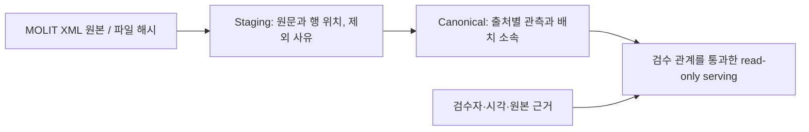

# 집담 · 출처를 보존하는 부동산 데이터와 추천 준비 상태 관리

서울 아파트 전월세 단지 후보를 예산·직장·생활조건에 맞춰 비교하는 진행 중인 팀 프로젝트입니다. 2026.10.19 확인한 main은 `dfd65523de303d060c2bb1c1b5102730feeeaff9`입니다.

## 문제와 내 역할

개인 부동이 고도화에서 실제 답변 품질을 검증하는 기준에 한계를 경험했습니다. 부동산 경험이 있는 팀원과 하네스 엔지니어링에 관심 있는 팀원을 모아 2026.10.01 집담을 시작했습니다. 기존 사용자 확인 기준 4인 팀이며, 문제 정의는 공동 논의입니다.

**데이터 수집, 통합 DB, 추천 웹의 설계·구현을 담당했습니다.** 팀 구성, 개발 환경, SDD 운영 기반, 에이전트 작업 규칙·위키도 주도했습니다. 하네스는 팀원이 가져온 **Claude Code CLI용 기존 기반에서 적용 가능한 부분을 선별해 집담에 통합·보완**했습니다. 하네스의 최초 기반 제공은 팀원 기여이며, 데이터·서비스 구현과 하네스 적용·통합은 제 기여입니다. 기여 범위는 2026.10.19 사용자 확인을 반영했습니다.

## 1. 원본에서 공통 관측까지

자료 확보와 추천 적격성은 별개입니다. XML 응답 원문·페이지·수집 시각·SHA-256을 보존하고, 단위·기간·필수 필드를 검증해 staging에 남깁니다. `observations`는 원본 행과 매핑 버전에, `batch_observations`는 배치별 소속에 연결합니다. 겹치는 범위를 재사용해도 관측을 중복 생성하지 않도록 설계했습니다.

| 설계 판단 | 구현 근거와 의미 |
|---|---|
| 원본 콘텐츠와 배치 소속 분리 | `raw_blobs/raw_files/raw_items`, `batch_files/batch_observations`. 같은 원본의 재사용과 수집 이력을 함께 보존 |
| 공식 출처 ID의 namespace 보존 | MOLIT `aptSeq`는 단지 ID. 거래·건물 ID로 확대 해석하지 않음 |
| 미확정 매칭 격리 | `match_candidates`의 pending/unverified, 점수 NULL. 후보를 자동 확정 FK로 만들지 않음 |
| 이전 결과 불변 | 봉인 DB를 새 출력으로 복사해 증분 적재. 같은 배치·버전의 다른 입력은 거부 |
| 행 수준 계보 | 관측에서 원본 파일·SHA·행 위치로 조인. 기간 밖·거부 항목의 사유 보존 |
| 별도 통계 저장소 | 제공 XLSX의 숫자/결측·단위·기간·source_view를 보존. 거래 관측과 이중 집계하지 않음 |

### 감사 기록의 서로 다른 범위

| 기록 | 범위·관측 결과 | 해석 조건 |
|---|---|---|
| 10월 13일 canonical 감사 | 원본 384,211행 = 유효 관측 374,892 + 기간 밖 9,319 + 거부 0 | 세 API의 출처별 관측. 고유 거래 수가 아님 |
| 같은 canonical 배치 | 단지 5,890, 주소 5,839. 전체 유효 관측 계보 374,892행, FK 위반 0 | 원천 품질 `source_unverified`, 추천 검수 완료 아님 |
| 동일 배치 재적재 | 17개 테이블 추가 행 0, 정렬 전체 행 digest 일치 | DB 파일 바이트 해시 일치와 의미상 행 일치를 구분 |
| 10월 15일 별도 역사 수집 | 2024.01–2026.08, 서울 25구×32개월×3 API = 2,400 query 완료. 전월세 685,575행, 매매 일반/상세 각 192,142행 | 앞의 canonical 374,892에 이 수치를 덧붙이지 않음. 새 범위의 canonical 통합/추천 연결 완료 아님 |
| 10월 13일 통계 적재 | 제공 XLSX30개, 날짜셀 530,556 = 숫자 483,979 + 결측 46,577 | 거래 건수가 아닌 통계 셀. 같은 배치 재적재 신규 0 |

대규모 수치는 저장소의 날짜별 감사 기록을 인용했습니다. 이번 포트폴리오 작업은 원본 DB를 받거나 재집계하지 않았습니다.

## 2. SQL 병목과 재실행 검증

초기 계보 조회는 `staging_state(batch_id=?)` 인덱스로 배치 전체를 반복 검색했습니다. 원본 파일·해시·행 위치로 계산한 `raw_item_id`를 함께 조건에 넣어 `staging_items`의 `(batch_id,raw_item_id)` 복합 PK 검색을 사용하도록 바꾼 기록이 있습니다.

수정 전/후를 같은 합성 1,000행, SQLite VM 500만 명령 제한으로 검사했습니다. 이전 쿼리는 interrupted로 실패하고 수정 후 검사가 통과했습니다. 이 증거는 연산량 회귀 해결이며 측정되지 않은 배속을 주장하지 않습니다. 실제 전체 적재에서는 계보 374,892행과 무결성·재실행 digest를 대사했습니다.

코드: [collection_integrate.py](https://github.com/keulreobeu/jipdam/blob/dfd65523de303d060c2bb1c1b5102730feeeaff9/outputs/budongi_mvp_temp/src/budongi/collection_integrate.py)

## 3. 추천 웹과 데이터 준비 게이트

현재 저장소에는 대화형 조건 초안, 사용자의 확인·수정, 결정적 추천, 니즈/전체정보 비교, 100행 거래 상세, Leaflet 지도 경로가 구현돼 있습니다. 백엔드가 최신 계약·예산·필수/선호 조건·순위를 계산합니다. LLM은 허용된 조건 초안/설명 역할이며 SQL·DB를 직접 실행하지 않습니다.

MOLIT 원본 적재가 끝났다는 이유로 추천을 열지 않습니다. 승인된 검수 패키지의 원본 해시·검수자·시각·관계와 WGS84 좌표 근거가 있어야 serving 적격성을 갖습니다. 조건은 met/unmet/unknown으로 구분하고 필수 unknown은 통과시키지 않습니다.

**저장소의 실제 serving 기록은 전월세 관측 238,620건, 확정 단지 연결 0건이며 결과는 `data_not_ready`입니다.** 원본 685,575건 수집 기록은 별도 배치이므로 이 serving 수치를 대체하지 않습니다. 과거 거래는 현재 계약 가능한 매물이 아닙니다. 직선거리는 통근시간이나 장애인 접근성 검증이 아닙니다.

합성 성공 경로(1,001단지·20,102관측·2,000시설)의 기존 계측은 추천 p95 152.667ms, 상세 100행 p95 78.706ms입니다. 5회 워밍업 후 100회, DB 연결·판정·JSON 구성 기준이며 LLM/외부 지도는 제외했습니다. 실제 후보가 있는 경로의 성능이나 사용자 효용으로 옮겨 쓰지 않습니다. 실제 미준비 응답도 날짜별 계측 값이 달라 임의의 가장 빠른 값을 대표 지표로 택하지 않았습니다.

## 4. SDD와 CLI 하네스

팀은 Spec·ADR·Task·AC·테스트와 `traceability.json`을 연결합니다. 요구와 검증 기록을 함께 남겨 에이전트가 한 일의 완료 범위를 확인하도록 했습니다.

팀원이 제공한 Claude Code CLI용 하네스 기반을 검토하고 적용 가능한 부분을 집담에 통합·보완했습니다. 현재 CLI 하네스에는 작업 등록·우선순위·의존성, 별도 Git worktree, SQLite 상태/이벤트, lease/PID 복구, pause/resume/cancel/retry, 검증과 명시 승인, 허용 경로 자동 커밋이 있습니다. 코드 변경 후 검증 증거의 commit·파일 해시·범위가 달라지면 이전 승인으로 통과시키지 않습니다. GMS 경로는 기존 예산 runner에서 초안을 받아 사람이 적용·검증하는 경로입니다.

현재 한계: native GMS 전체 Responses/도구/SSE 호환은 미완료, Claude/Antigravity 실제 native 세션은 미검증, 분산 실행과 외부효과 exactly-once는 지원하지 않습니다. 자동 push/merge·실수집·매칭 승인을 포함하는 시스템으로 설명하지 않습니다.

## 5. 이번 확인과 남은 과제

2026.10.19 고정 main을 별도 폴더에 clone하고 번들 Python3.12로 기존 제품 unittest **281개 OK(49.552초)**를 확인했습니다. 첫 sandbox 실행은 Temp/loopback 권한 오류였고 같은 코드를 허용 로컬 실행에서 재검증했습니다. API 수집·유료 모델 호출·실제 추천 품질 평가는 실행하지 않았습니다.

같은 main의 [GitHub CI](https://github.com/keulreobeu/jipdam/actions/runs/38684231404)는 success입니다. 더 최근 별도 브랜치 `5e4843d`의 [CI](https://github.com/keulreobeu/jipdam/actions/runs/38705267401)는 failure이므로 해당 후보 검수 내보내기를 main의 완료 성과에 포함하지 않았습니다.

남은 과제는 승인된 실제 검수 관계·좌표·시설·커버리지, 지정 로컬 모델, 실제 후보가 있는 추천/상세의 품질과 지연 검증입니다. 데이터 기반과 웹 기능을 구현한 진척, 제품 전체 완료를 구분합니다.

[실행·재현](reproduce.md) · [정확한 근거 위치](evidence.md) · [전체 포트폴리오](../README.md)
